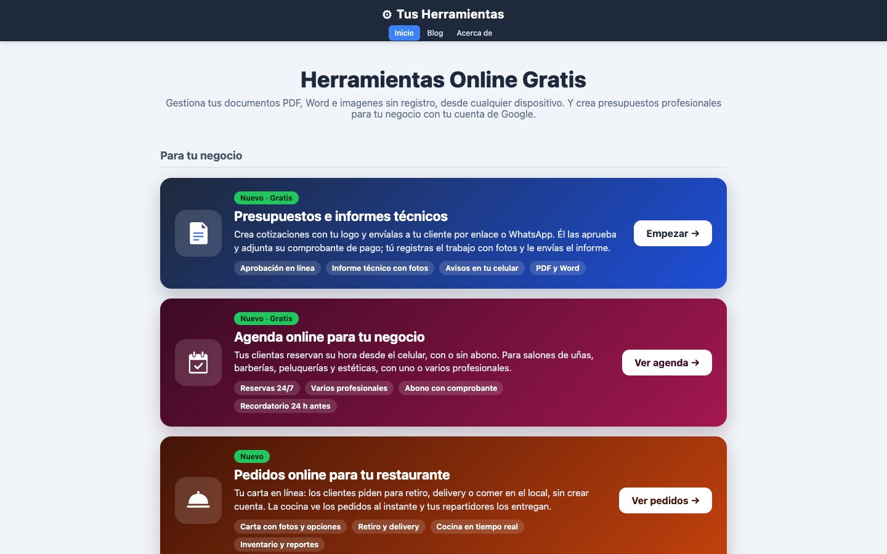
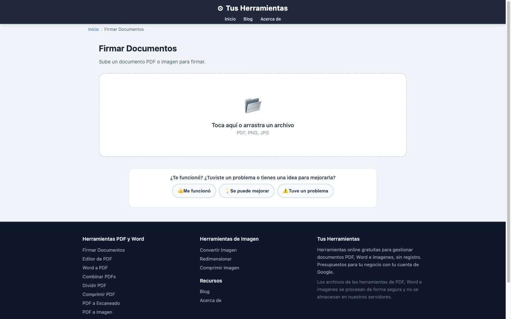
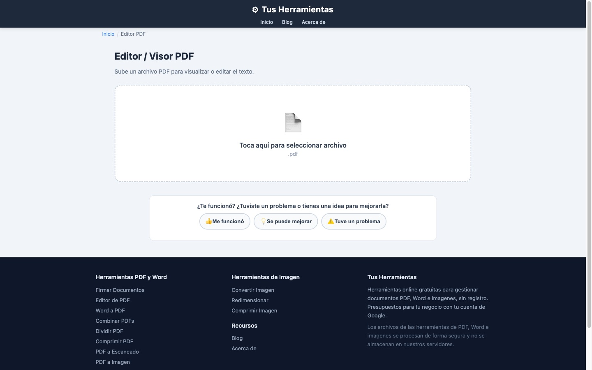
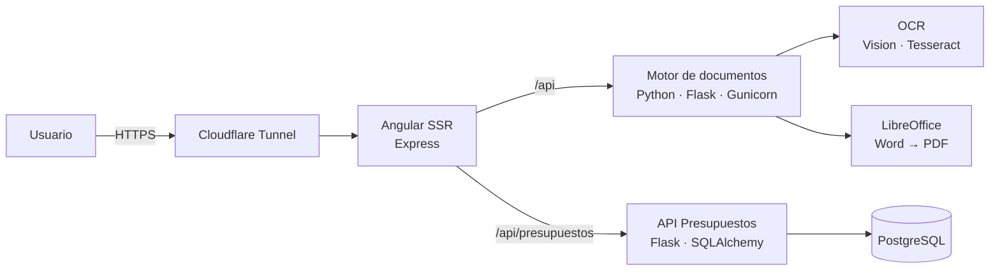

# Tus Herramientas 🧰

**🌐 [tusherramientas.org](https://tusherramientas.org)** · Herramientas online gratis para PDF, Word e imágenes

Herramientas **gratis y sin registro** para trabajar con documentos desde cualquier dispositivo, más una app de **presupuestos e informes técnicos** para pequeños negocios.

> 🔒 **El código fuente es privado.** Este repositorio muestra el proyecto con fines de portafolio. Si quieres conversar sobre cómo está construido, escríbeme: [hernays.dubenails.com](https://hernays.dubenails.com).

## Herramientas

| Documentos PDF | Word | Imágenes |
|---|---|---|
| Editor de PDF **en el lugar** | Editor que modifica el `.docx` original | Convertir formato |
| Firmar documentos | Word a PDF | Redimensionar |
| Combinar, dividir y comprimir | PDF o foto a Word, con OCR | Comprimir |
| PDF a imagen e imagen a PDF | | |
| OCR de páginas escaneadas | | |
| "PDF a escaneado" | | |

**Presupuestos:** cotizaciones con tu logo que el cliente aprueba por un enlace o por WhatsApp, comprobantes de pago, informes técnicos con fotos y avisos en el celular. Login con Google.

## Lo interesante: editar un PDF sin romperlo

La mayoría de los editores en línea rehacen el PDF entero, y el resultado pierde fuentes, cambia espacios o rompe el diseño. Este motor hace lo contrario: **toca solo la línea que editaste.**

1. Detecta la línea, su alineación (izquierda, centro, derecha o justificada) y la rotación de la página.
2. Borra solo ese texto, sin tocar las imágenes ni los vectores que hay debajo.
3. Escribe el texto nuevo en la misma línea base, con una fuente libre de **métricas equivalentes** a la original (Arial → Liberation Sans, Calibri → Carlito, Times → Liberation Serif…), para que el texto ocupe el mismo ancho.
4. En páginas escaneadas primero aplica OCR, y al borrar rellena con el color real del papel.

El editor de Word sigue la misma idea: abre el `.docx` original y aplica un **diff de caracteres** dentro de los fragmentos de formato que ya existen, así que todo lo que no editaste queda intacto.

**Cómo se prueba:** hay suites automáticas que comparan **los píxeles fuera de la línea editada** (PDF) y **el XML de todo lo no editado** (Word). Si algo cambia donde no debía, la prueba falla.

## Capturas

| Firmar documentos | Editor de PDF |
|---|---|
|  |  |

## Arquitectura

- **Frontend:** Angular 16 con SSR, con SEO por herramienta, sitemap e IndexNow. Las firmas se hacen en el navegador con `pdf-lib`: el documento no sale de tu equipo.
- **Motor de documentos:** Python con PyMuPDF, Pillow y fontTools, OCR con Vision de macOS y respaldo en Tesseract, y conversión con LibreOffice headless.
- **Presupuestos:** Flask + SQLAlchemy + Alembic sobre PostgreSQL, con PDFs generados con WeasyPrint.
- **Seguridad:** límites de tamaño de archivo y de uso por IP. Los archivos se procesan y no se guardan.
- **Operación:** entorno de pruebas antes de producción, con despliegue y rollback por scripts.

## Stack

---

© 2026 Hernays Gonzalez Vibanco · Todos los derechos reservados
